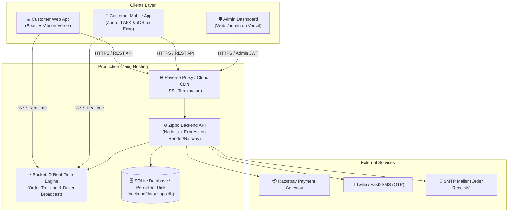

# Zippo — Complete Production Live Setup & Deployment Guide

> **Zippo**: Everyday Quick Commerce Delivery Super App (Cut Veggies, Groceries, Cakes, 20L Water, Pooja Flowers & Electricals).
> This document provides end-to-end instructions for taking the **Backend API**, **Customer Web App**, and **Android & iOS Mobile Apps** live.

---

## 🏗️ System Architecture



---

## 📋 Accounts Checklist Before Going Live

| Service | Purpose | Free Tier / Cost |
| :--- | :--- | :--- |
| **GitHub** | Code repository & CI/CD deployment trigger | Free |
| **Render.com / Railway.app** | Backend Node.js server with WebSockets | Free / ~$5/mo |
| **Vercel / Netlify** | Frontend React web application hosting | 100% Free |
| **Expo.dev (EAS)** | Cloud building Android APK/AAB and iOS IPA | Free tier includes free builds |
| **Custom Domain (e.g. GoDaddy/Namecheap)** | Brand identity (e.g. `zippo.in`, `zippoapp.com`) | ~$10 - $15/year |
| **Razorpay** | Online Payment Gateway (UPI, Cards, Netbanking) | 2% per transaction |
| **Google Play Console** | Publishing Android App to Play Store | $25 one-time fee |
| **Apple Developer** | Publishing iOS App to App Store | $99/year |

---

## 🚀 Step 1: Deploy Backend API & Database

The backend provides the REST APIs and WebSockets that power both the website and the mobile app.

### Recommended Host: Render.com (Web Service)

1. Push your latest code to GitHub:
   ```bash
   git add .
   git commit -m "feat: ready for live cloud deployment"
   git push origin main
   ```
2. Log in to [Render.com](https://render.com/) and click **New +** ➔ **Web Service**.
3. Connect your GitHub repository.
4. Configure the Web Service settings:
   - **Name**: `zippo-backend`
   - **Root Directory**: `backend`
   - **Environment**: `Node`
   - **Branch**: `main`
   - **Build Command**: `npm install`
   - **Start Command**: `node server.js`
   - **Instance Type**: `Free` or `Starter` ($7/mo for 24/7 always-on without sleep)
5. Add **Persistent Disk** (Recommended for SQLite):
   - Go to the service's **Disks** tab ➔ **Add Disk**.
   - **Name**: `zippo-data`
   - **Mount Path**: `/opt/render/project/src/backend/data`
   - **Size**: `1 GB` (Plenty for thousands of orders and products)
6. Add **Environment Variables** in Render's **Environment** tab:
   ```env
   PORT=4000
   NODE_ENV=production
   ADMIN_PASSWORD=SetAStrongAdminPasswordHere123
   JWT_SECRET=super-long-secure-random-jwt-secret-string-at-least-32-chars
   ALLOWED_ORIGINS=*
   ```
   *(Optional SMTP & SMS settings):*
   ```env
   SMTP_HOST=smtp.gmail.com
   SMTP_PORT=587
   SMTP_USER=your-business@gmail.com
   SMTP_PASS=your-16-char-gmail-app-password
   MAIL_FROM="Zippo Orders <support@zippo.in>"
   ```
7. Click **Create Web Service**.
8. Once deployed, Render will provide a live URL, for example:
   ```
   https://zippo-backend.onrender.com
   ```
9. **Verify Health**: Open `https://zippo-backend.onrender.com/api/products` in your browser. You should see the dynamic JSON list of all 37 products.

---

## 🌐 Step 2: Deploy Customer Website (Frontend)

The frontend is a fast Single Page App (React + Vite) with client-side routing.

### Recommended Host: Vercel

1. Log in to [Vercel.com](https://vercel.com/) and click **Add New** ➔ **Project**.
2. Import your GitHub repository.
3. Configure project settings:
   - **Project Name**: `zippo-app`
   - **Framework Preset**: `Vite`
   - **Root Directory**: Click *Edit* and select `frontend`
   - **Build Command**: `npm run build`
   - **Output Directory**: `dist`
4. Expand **Environment Variables** and add:
   - **Key**: `VITE_API_URL`
   - **Value**: `https://zippo-backend.onrender.com` (Your live backend URL from Step 1)
5. Click **Deploy**.
6. In ~60 seconds, your website will be live at `https://zippo-app.vercel.app`.
7. **Custom Domain Setup**:
   - Go to **Project Settings** ➔ **Domains**.
   - Add your domain: `zippo.in` and `www.zippo.in`.
   - Vercel gives you DNS records (A Record: `76.76.21.21` or CNAME: `cname.vercel-dns.com`).
   - Add them to your domain registrar (GoDaddy, Namecheap, Cloudflare).
   - Free SSL is provisioned automatically in 5 minutes!

---

## 📱 Step 3: Build & Publish Mobile App (Android & iOS)

The mobile app is built with React Native and Expo. We have configured `mobile/eas.json` for instant builds.

### 1. Set Live Backend URL in Mobile
Ensure [mobile/src/config.ts](file:///d:/chop-and-drop-website/chop-and-drop/mobile/src/config.ts) points to your live backend:
```typescript
export const PROD_API_URL = 'https://zippo-backend.onrender.com'
```

### 2. Install & Login to Expo EAS CLI
Open PowerShell in your terminal:
```powershell
npm install -g eas-cli
eas login
```
*(If you don't have an Expo account, create a free one at [expo.dev](https://expo.dev/signup)).*

### 3. Generate Direct Download Android APK (For beta testing & WhatsApp sharing)
Run this command from inside the `mobile` folder:
```powershell
cd mobile
eas build -p android --profile preview
```
- EAS will build the `.apk` in the cloud.
- When finished, you will receive a direct QR code and download link.
- Anyone can download and install this `.apk` directly on Android phones!

### 4. Build for Google Play Store (Production AAB)
```powershell
eas build -p android --profile production
```
- This generates an optimized `.aab` (Android App Bundle).
- Download the `.aab` file from your Expo dashboard.
- Log in to [Google Play Console](https://play.google.com/console), create an app named **Zippo**, upload the `.aab`, fill in store listing details, and submit for review.

### 5. Build for Apple App Store (iOS)
```powershell
eas build -p ios --profile production
```
- EAS manages your Apple certificates and provisioning profiles.
- When completed, submit directly to TestFlight or the App Store:
```powershell
eas submit -p ios
```

---

## 💳 Step 4: Live Payment Gateway (Razorpay)

To accept live UPI, Cards, and Netbanking payments:
1. Sign up at [Razorpay.com](https://razorpay.com/) and complete KYC.
2. Toggle from **Test Mode** to **Live Mode** in the dashboard.
3. Generate **Key ID** and **Key Secret**.
4. In your backend environment variables on Render, add:
   ```env
   RAZORPAY_KEY_ID=rzp_live_xxxxxxxxxxxx
   RAZORPAY_KEY_SECRET=your_live_secret_key
   ```
5. In frontend environment variables on Vercel, add:
   ```env
   VITE_RAZORPAY_KEY_ID=rzp_live_xxxxxxxxxxxx
   ```

---

## 🛡️ Step 5: Admin Dashboard Access

1. Open your live website: `https://your-domain.com/admin`
2. Enter the `ADMIN_PASSWORD` you configured in Step 1.
3. Features available in the live admin dashboard:
   - Live incoming orders with real-time audio/visual alert.
   - Status updates (`Pending` ➔ `Confirmed` ➔ `Out for Delivery` ➔ `Delivered`).
   - Customer support tickets view & response.
   - Site traffic analytics & registered users list.

---

## 💾 Step 6: Backup & Maintenance

### SQLite Database Backup
The live database is stored in `backend/data/zippo.db`.
- **Download Backup**:
  If using Render with persistent disk or a VPS, download `zippo.db` periodically via SSH or SCP:
  ```bash
  scp user@your-server:/path/to/backend/data/zippo.db ./zippo-backup-$(date +%F).db
  ```
- **MongoDB Atlas Alternative**:
  If you prefer a managed cloud DB with automated daily backups, create a free MongoDB Atlas cluster and set `MONGODB_URI=mongodb+srv://...` in your backend `.env`.

---

## 📞 Troubleshooting Common Issues

1. **CORS Error on Web**:
   Ensure `ALLOWED_ORIGINS` in Render backend env includes your Vercel URL (e.g. `ALLOWED_ORIGINS=https://zippo.vercel.app,https://zippo.in` or `ALLOWED_ORIGINS=*`).
2. **Mobile App says Network Error**:
   Ensure [mobile/src/config.ts](file:///d:/chop-and-drop-website/chop-and-drop/mobile/src/config.ts) has `https://` (not `http://`) because Android and iOS block cleartext HTTP traffic in production by default.
3. **Admin login fails**:
   Verify `ADMIN_PASSWORD` matches the value configured in Render environment variables.
